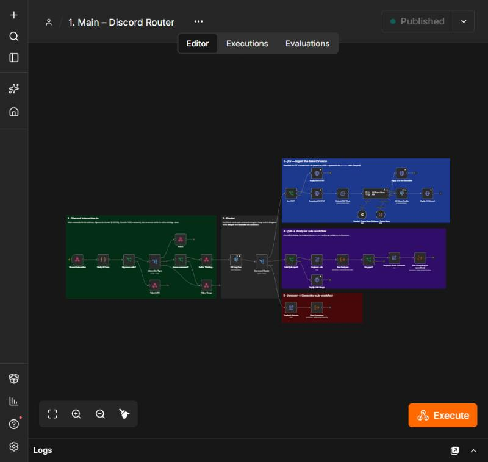

# Application Assistant

A Discord bot built with n8n that tailors my CV, cover letter and interview prep to each job offer. I upload my CV once, send an offer, answer one question about what's missing, and get back a tailored CV (PDF), a cover letter and a cheat sheet in Google Docs. Everything I confirm is remembered for the next offers.

No-Code Software Development project, Pollux Gronier, ESSEC/CentraleSupélec AIDAMS, October 2026. Presentation notes: [`docs/presentation-guide.md`](docs/presentation-guide.md).

**The need:** students applying to many internships rewrite their CV and letter by hand for every offer, or paste their CV, the offer and a prompt into ChatGPT each time, which also invents skills they don't have.

## What it does

| Command | Result |
|---|---|
| `/cv file:<cv.pdf>` | Reads the CV once; an LLM turns it into JSON, saved in Postgres. Not a PDF → "attach a PDF". |
| `/job url:<link>` or `/job text:<offer>` | Reads the offer, an LLM lists the requirements, a Code node compares them with my CV: score /10, skills found / missing, and **one** question about the missing ones. Bad link → usage message; blocked page → "paste the text". |
| `/answer text:<answer>` | Saves what I confirm (or don't have), then writes the tailored CV (5 fields of my Google Docs template), the letter and the cheat sheet, in the offer's language. About 1 minute. |
| `/help` (or anything unknown) | Usage message. |

## Architecture

Five workflows, one job each (exported in `workflows/`):

| File | Trigger | Role |
|---|---|---|
| `1-main-discord-router.json` | Discord slash command (Webhook) | Checks Discord's signature (Code), answers "thinking…" within 3 s, logs the run, validates input, **Command Router** (Switch) → `/cv`, `/job`, `/answer` |
| `2-sub-analyzer.json` | Execute Workflow (defined inputs) | Fetch the offer → LLM extracts requirements + synonyms → **Code: Gap Analysis** → one question → session saved |
| `3-sub-generator.json` | Execute Workflow (defined inputs) | Learn from the answer → LLM tailors the CV, letter, cheat sheet → Google Drive/Docs → PDF back in Discord |
| `4-error-handler.json` | Error Trigger | Discord alert with workflow name, failing node, error and execution URL; tells the user |
| `0-setup-register-commands.json` | Manual, once | Registers the 4 slash commands |
| `5-inspect-database.json` | Manual | Shows the project tables (for the demo) |

```
Discord ──signed POST──► 1. Main ──/job──► 2. Analyzer ──no gaps──► 3. Generator
   ▲  "thinking…" < 3 s      │  ──/answer─────────────────────────────►   │
   └──── edit that message: reply, PDF, links ◄────────────────────────────┘
```

APIs: Discord (interactions + webhook edits), OpenRouter (Gemini 3.5 Flash, 6 LLM chains), Google Drive and Docs, the job pages (HTTP). Database: Postgres, tables `profiles`, `facts`, `sessions`, `runs` (see `db/init/01-assistant-db.sh`).



More screenshots in [`docs/screenshots/`](docs/screenshots): Analyzer, Generator, Error Handler, Executions, Discord.

## Run it locally with Docker

Requirements: Docker Desktop (Compose v2) and Git Bash.

```bash
git clone https://github.com/Polluxgnr/application-assistant.git
cd application-assistant
cp .env.example .env          # fill it (see below)
docker compose up -d
docker compose ps             # postgres and n8n "healthy"
```

Open http://localhost:5678 and create the owner account. On its first start, Postgres also creates the project database `assistant` and its tables. Data survives a restart (named volumes `pg_data`, `n8n_data`):

```bash
docker compose down && docker compose up -d   # workflows and data are still there
```

**`.env`:** a random `N8N_ENCRYPTION_KEY` and `POSTGRES_PASSWORD`, the Discord ids and public key, the Google template and folder ids, and 4 secrets: Discord bot token, OpenRouter key, Google OAuth client id and secret. Then:

```bash
bash scripts/import.sh        # credentials (secrets loaded from .env once) + the workflows, published
bash scripts/tunnel-url.sh    # public HTTPS URL of the Cloudflare tunnel
```

1. In n8n, open *Google Drive account* and *Google Docs account* and click **Sign in with Google** (from a normal browser: it opens a pop-up).
2. Discord Developer Portal → General Information → **Interactions Endpoint URL** = the URL printed above.
3. Run *0. Setup* once, then `/help` in Discord.

Google Cloud: enable the **Drive** and **Docs** APIs, OAuth client "Web application" with redirect `http://localhost:5678/rest/oauth2-credential/callback`, and add your Google account as a test user. I hit each of these three.

Tested on 22 October 2026 from a fresh clone: Postgres healthy with the 4 tables, n8n `/healthz` 200, 6 workflows imported, still present after down / up.

## How to test

Each sub-workflow has a saved test payload pinned on its *Start* node (also in `tests/payloads/`), so it can be run from the editor without Discord.

| Send | Expected |
|---|---|
| `/help` | Usage message |
| `/cv` with a PDF | "CV saved: 29 skills/tools, 6 experiences" |
| `/job url:` Qonto data engineering intern | 7/10, one question |
| `/answer` | CV PDF + letter + cheat sheet links |
| Same `/answer` again | "No job in progress", nothing new saved |
| `/job text:` a French offer (Papernest) | 9/10, question and letter in French |
| `/job url:hello` | Usage message |
| `/job url:https://this-does-not-exist.invalid/job` | 3 retries, then "I couldn't read that page" |
| Google Docs API disabled (happened for real) | User told + one admin alert with the execution link |

Also tested: Ipsos (data scientist, 9/10, the letter states a real gap instead of inventing it) and Batch (data analyst, 7/10).

## Security

- No secret is stored in this repository: n8n exports only credential names and ids, `.env` is git-ignored, the history was scanned for tokens and keys.
- `N8N_ENCRYPTION_KEY` comes from the environment; keep a copy, without it the stored credentials can't be decrypted.
- Every Discord request is checked with its Ed25519 signature (401 otherwise).

## Limits

Built for one person (my CV template); the bot trusts my answers; one job at a time; the quick tunnel URL changes when it restarts; right after a start, send `/help` once (the first command can miss Discord's 3-second window).

## Use of AI

An AI assistant was used throughout the project: to design the workflows, write the Code nodes, prompts and SQL, set up Docker, and run and debug the tests.
